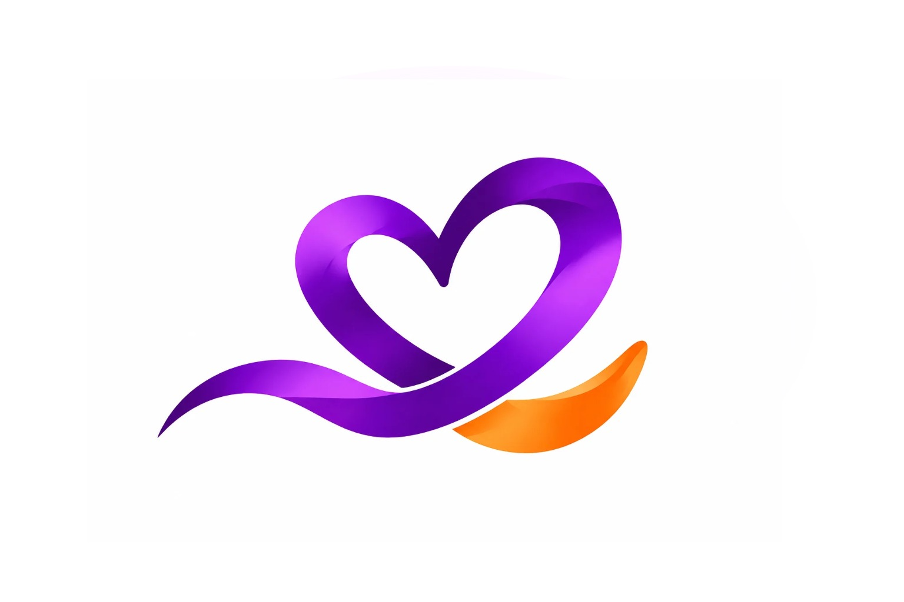

<div align="center">
  
  <h1>Laços Solidários</h1>
  <p><strong>"Pequenos gestos, grandes transformações."</strong></p>
  <p>Plataforma web Mobile-First criada para conectar quem precisa de apoio emergencial a vizinhos, doadores, voluntários e ONGs parceiras.</p>
</div>

---

## Sobre o Projeto

O **Laços Solidários** é uma rede de apoio comunitário desenvolvida com foco em acessibilidade, clareza visual e praticidade no uso pelo celular. A plataforma centraliza pedidos urgentes, doações de itens essenciais, ações de voluntariado e divulgação de instituições sociais em um único ambiente.

O projeto dialoga diretamente com os Objetivos de Desenvolvimento Sustentável (ODS) da ONU:

* **ODS 1** — Erradicação da Pobreza
* **ODS 10** — Redução das Desigualdades
* **ODS 11** — Cidades e Comunidades Sustentáveis

---

## Estrutura da Plataforma

* **Início:** Painel principal com acesso rápido para pedir ou oferecer ajuda, busca por categorias, pedidos urgentes em destaque e indicadores de impacto coletivo.
* **Pedidos:** Mural para divulgação e acompanhamento de solicitações de apoio na comunidade, organizadas por categoria e localização por bairro/cidade.
* **Doações:** Espaço dedicado à oferta e solicitação de itens físicos, como alimentos, roupas, produtos de higiene e fraldas.
* **Voluntariado:** Área para conectar pessoas dispostas a oferecer tempo e apoio cotidiano a quem precisa na região.
* **ONGs:** Vitrine para instituições e projetos sociais apresentarem suas causas, campanhas ativas e necessidades prioritárias.

---

## Tecnologias Utilizadas

* **HTML5** — Estruturação semântica das páginas
* **CSS3** — Estilização responsiva (Mobile-First) e variáveis globais
* **JavaScript** — Interatividade, filtros, formulários e manipulação do DOM
* **LocalStorage** — Armazenamento local de dados no navegador
* **Git e GitHub Pages** — Versionamento de código e publicação

---

## Identidade Visual

### Tipografia
* **Títulos principais:** Montserrat
* **Subtítulos e botões:** Poppins
* **Corpo de texto:** Merriweather

### Paleta de Cores

| Aplicação | Cor | Hexadecimal |
| :--- | :--- | :--- |
| Identidade Principal e Filtro Ativo | Roxo Vibrante | `#5B21B6` / `#6D28D9` |
| Badges e Fundos de Destaque | Lilás Claro / Pastel | `#EDE9FE` / `#F5F3FF` |
| Ações Principais e Urgência | Laranja Vibrante | `#F97316` / `#EA580C` |
| Badges e Botões Secundários | Laranja Claro / Pêssego | `#FFEDD5` / `#FFF7ED` |
| Alerta de Prazo | Coral Suave / Vermelho | `#FEE2E2` / `#DC2626` |
| Superfícies e Cartões | Branco / Lavanda Suave | `#FFFFFF` / `#F8F7FC` / `#F3F0FA` |
| Textos | Grafite / Cinza Médio | `#1F2937` / `#374151` / `#6B7280` |

---

## Estrutura de Pastas

```text
LacosSolidarios/
├── css/
│   └── style_index.css     # Folha de estilos principal e variáveis globais
├── imgs/
│   ├── minilogo.jpeg       # # Logotipo principal (JPEG)
│   └── minilogo.svg        # Versão vetorial reduzida do logotipo (SVG)
├── js/
│   └── script.js           # Scripts de interatividade e armazenamento local
├── paginas/                # Páginas secundárias da aplicação
├── index.html              # Página inicial
└── README.md               # Documentação do repositório