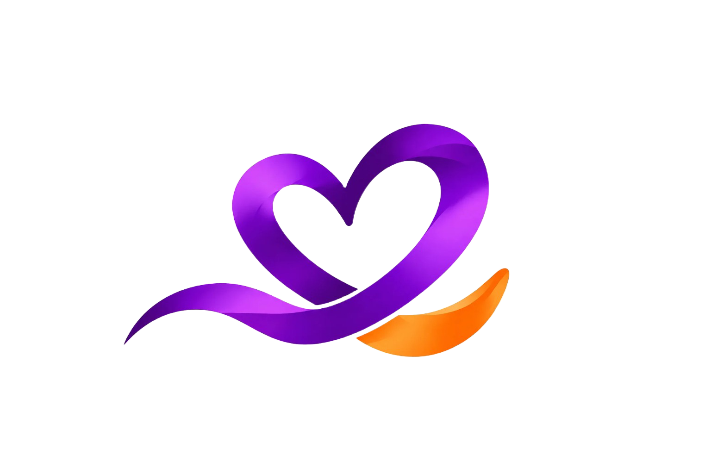

<div align="center">
  
  <h1>Laços Solidários</h1>
  <p><strong>"Pequenos gestos, grandes transformações."</strong></p>
  <p>Projeto social que conecta pessoas que precisam de ajuda a pessoas dispostas a colaborar, transformando a solidariedade em uma ação acessível à comunidade.</p>
</div>

---

## Sobre o Projeto

O **Laços Solidários** é uma plataforma criada para aproximar pessoas e fortalecer os vínculos comunitários. A iniciativa reúne e divulga pedidos de ajuda, doações, serviços voluntários e ações sociais em um único ambiente, ampliando as possibilidades de participação no dia a dia.

> *"Quando cada gesto se transforma em ação, juntos construímos uma comunidade mais solidária."*

---

## Estrutura da Plataforma

- **Início (Topo e Busca):** Cabeçalho de navegação, apresentação da rede solidária, acessos diretos (*Pedir Ajuda* e *Quero Ajudar*) e campo de busca por localização e tipo de necessidade.
- **Pedidos de Ajuda:** Lista de solicitações da comunidade com descrição, bairro/cidade, distância aproximada, barra de progresso da meta e botão *Oferecer Ajuda*.
- **Doações e Voluntariado:** Espaços voltados para divulgar doações, serviços voluntários e diversas formas de colaborar com a região.
- **ONGs e Participação Comunitária:** Divulgação de iniciativas e ONGs parceiras, indicadores de impacto coletivo e chamada para cadastro de comércios como ponto de coleta (*Seja um Ponto Solidário*).

---

## Tecnologias Utilizadas

- **HTML5** — Estruturação semântica das páginas
- **CSS3** — Estilização responsiva (Mobile-First) e variáveis globais
- **JavaScript** — Interatividade, filtros, formulários e manipulação do DOM
- **LocalStorage** — Armazenamento local de dados no navegador
- **Git e GitHub** — Versionamento de código e colaboração

---

## Identidade Visual

### Logo do Projeto

O símbolo do **Laços Solidários** traduz o propósito da plataforma por meio de suas cores principais:

- **Roxo:** Empatia, cuidado e acolhimento — o coração que une quem precisa a quem pode ajudar.
- **Laranja:** Ação, energia e solidariedade — o gesto concreto que transforma o dia de alguém.

### Tipografia

- **Títulos principais:** Montserrat
- **Subtítulos e textos:** Poppins
- **Corpo de texto:** Merriweather

### Paleta de Cores

| Categoria | Cor | Hexadecimal | Aplicação |
| :--- | :--- | :--- | :--- |
| Neutros e Superfícies | Grama | `#ABB194` | Cor principal do projeto |
| Neutros e Superfícies | Branco / Fundo | `#FFFFFF` | Fundo das páginas e cartões |
| Neutros e Superfícies | Cinza Escuro | `#37393E` | Títulos e textos principais |
| Neutros e Superfícies | Cinza Médio | `#6B6B6B` | Textos de apoio e legendas |
| Roxo / Lilás (Identidade Principal) | Roxo Principal | `#6B3FA0` | Botões de ação e destaques |
| Roxo / Lilás (Identidade Principal) | Lilás Claro | `#E8DFF5` | Fundos suaves de cartões |
| Laranja / Âmbar (Ação e Urgência) | Laranja Vibrante | `#F26A21` | Chamadas para ação |
| Laranja / Âmbar (Ação e Urgência) | Laranja Claro | `#FCE3CE` | Fundos de aviso |
| Vermelho / Coral (Alerta de Prazo) | Vermelho Suave | `#F7B3A8` | Indicadores de prazo |

---

## Estrutura de Pastas

```text
LacosSolidarios/
├── css/
│   └── style_index.css              # Folha de estilos principal e variáveis globais
├── imgs/
│   ├── logo_fundo_transparente.png  # Logotipo principal com fundo transparente
│   ├── minilogo.jpeg                # Versão reduzida do logotipo (JPEG)
│   └── minilogo.svg                 # Versão vetorial reduzida do logotipo (SVG)
├── js/
│   └── script.js                    # Scripts de interatividade e armazenamento local
├── paginas/                         # Páginas secundárias da aplicação
├── index.html                       # Página inicial
└── README.md                        # Documentação do repositório